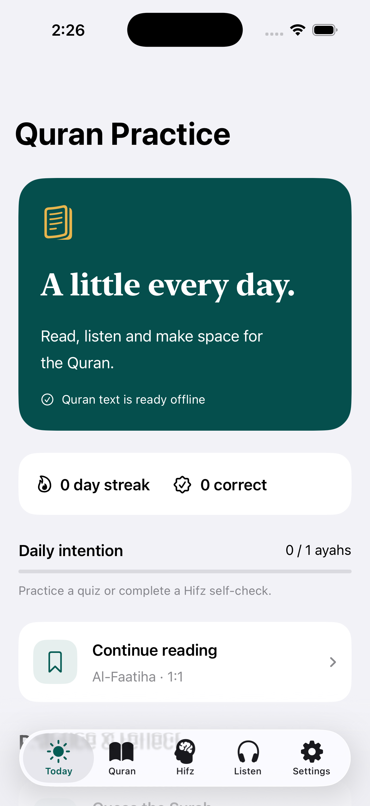
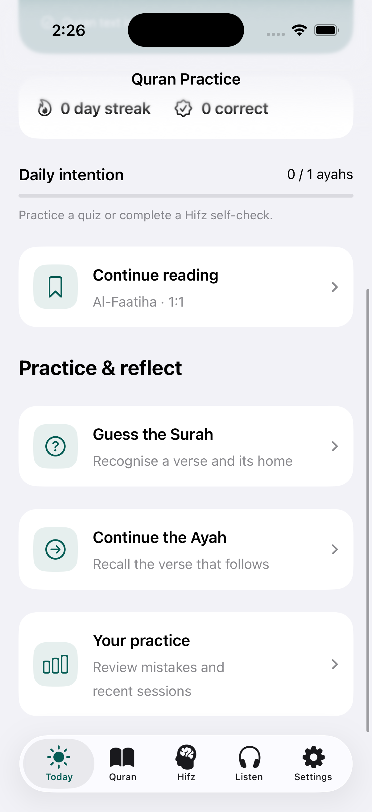
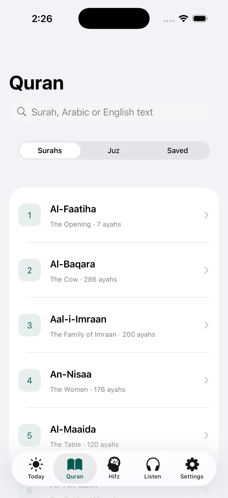
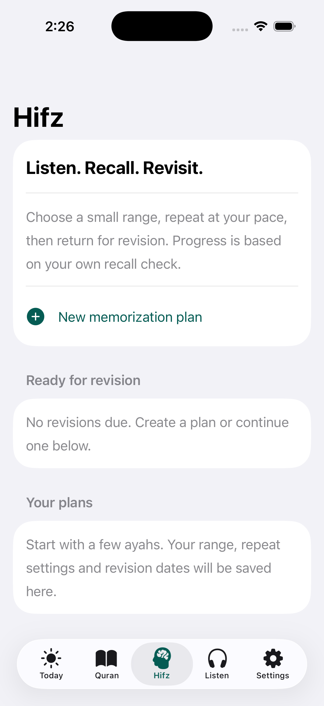
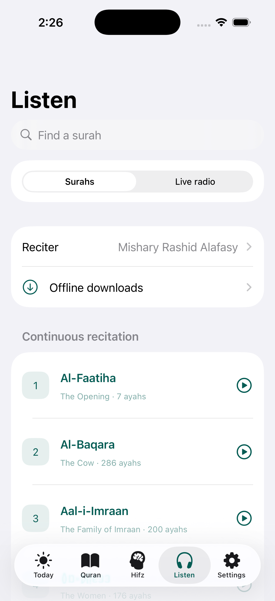

# 📖 QuranQuest

<p align="center">
  
</p>

**QuranQuest** is a beautiful, offline-first SwiftUI app that makes daily Quran practice simple: read, listen, memorize (Hifz), and test yourself with gentle quizzes — a little every day.

[](https://swift.org)
[](https://developer.apple.com/ios/)
[](https://developer.apple.com/xcode/swiftui/)
[](LICENSE)

---

## ✨ Features

- **🏠 Today** — a daily home with streak tracking, correct-answer stats, a daily intention goal, and "continue reading" resume
- **📖 Quran Reader** — browse all 114 surahs or by juz, search in Arabic or English, save/bookmark ayahs, full Arabic text with translation
- **🧠 Hifz (Memorization)** — create memorization plans with a surah/ayah range, repeat verses at your own pace, hide/reveal text, self-check recall, and scheduled revisions
- **🎧 Listen** — continuous surah recitation with multiple reciters, offline audio downloads, and live Quran radio
- **🎮 Quizzes** — *Guess the Surah* (recognise a verse's surah) and *Continue the Ayah* (recall the verse that follows)
- **🌙 Dark Mode, VoiceOver & Dynamic Type** supported

## 📱 Screenshots

| Today | Practice & Reflect | Quran | Hifz | Listen |
|:---:|:---:|:---:|:---:|:---:|
|  |  |  |  |  |

## 🛠 Tech Stack

- **SwiftUI** + MVVM architecture
- Native **URLSession** networking with proper error handling
- Quran text & audio from the [AlQuran Cloud API](https://alquran.cloud/api)
- Bundled offline surah metadata & Quran text (`quran.json`, `surahs.json`)
- `UserDefaults`-based persistence for progress, streaks, and plans

## 🚀 Getting Started

1. Clone the repository
   ```bash
   git clone https://github.com/awaisdev5765/QuranQuest.git
   ```
2. Open `QuranQuest.xcodeproj` in **Xcode 15+**
3. Select the **QuranQuest** scheme and run on an iOS 16.4+ simulator or device

## 📂 Project Structure

```
QuranQuest/
├── View/          # SwiftUI views (Today, Reader, Hifz, Listen, Quizzes)
├── ViewModel/     # MVVM view models
├── Model/         # Data models
├── Network/       # API client & error handling
├── Core/          # App-wide services & persistence
├── Helper/        # Utilities
└── Resources/     # Assets, bundled JSON
```

## 🤝 Contributing

Contributions are welcome! Open an issue or submit a pull request.

## ☕ Support

If this project helps you, please consider supporting my work:

<p align="center">
  <a href="https://buymeacoffee.com/awaisdev572">
    
  </a>
</p>

Or [become a supporter on Buy Me a Coffee](https://buymeacoffee.com/awaisdev572) 💛

## 📄 License

Released under the [MIT License](LICENSE).

## 🙏 Credits

- Quran text & audio: [AlQuran Cloud API](https://alquran.cloud/api)
- Original concept inspired by *Fun Quran Game* by [Muhammad Rezky Sulihin](https://www.linkedin.com/in/mrezkys/)
